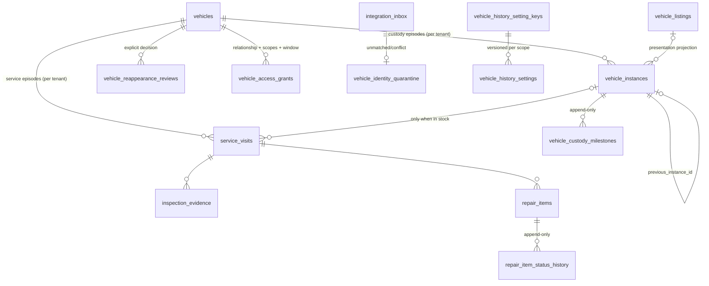

# Permanent vehicle history: implementation map

Branch `claude/vehicle-history-foundation`, built on `main` at b504898 plus the unmerged RooftopOS spine branch (PR #36, `claude/project-thread-9d8x1r`). Verified against the repository on 2026-11-01. Production was not queried in this pass; production facts below are quoted from project memory (2026-10-31) and marked as such.

The Oct 28 RooftopOS integration paste (`Pasted text(20261028-212337).txt`) is not in this environment. The repository copy of that package is PR #36, which this branch merges; its signed spine, inbox/outbox, tenant-from-credential rule and phased flags are the baseline here.

## 1. Current state

### Existing and used

| Component | Path | Consumers | Note for this work |
|---|---|---|---|
| `vehicle_listings` | `supabase/migrations/*`, unique `(tenant_id, upper(trim(vin)))` (prod, memory) | Everything | One listing per tenant/VIN forever, archived included. Treated as the presentation projection, not the custody record. |
| `vehicle_files` | `supabase/migrations/20260419100000_vehicle_files.sql` | `src/components/vehicleFile/*`, `src/hooks/useVehicleFiles.ts`, admin Vehicle files | Dealer vehicle record (unique tenant+VIN). Holds `deal_status` and customer name/phone/email columns directly, so a reacquisition would overwrite the prior buyer. Used here only as "this dealer already knows the VIN". |
| `vehicle_lifecycle` | `20260726220000_vehicle_lifecycle_foundation.sql` | `ManagerIntake`, `ServiceWriterDesk`, `TechnicianHome`, `components/vehicleFile/lifecycle.ts` | Recon/get-ready workflow state keyed to a listing (`ON DELETE CASCADE`). Not a custody model; left untouched. |
| Truth layer: `vehicle_source_records`, `vehicle_facts`, `vehicle_snapshots`, `vehicle_fact_conflicts`, `source_authority_rules`, `vehicle_change_history` | `20260727120000_vehicle_truth_layer.sql` and follow-ups | `src/lib/vehicleFile/*`, `src/lib/vehicleTruth/*`, `vehicle-file-read-model`, `factory-sticker-orchestrate` | Reused as the authority for decode/provider facts. Many FKs to `vehicle_listings` are `ON DELETE CASCADE` (memory, 2026-10-31), so deleting a listing destroys history. Not altered here; flagged for a separate gated migration. |
| `safety_inspections` (K-208), `used_vehicle_inspections`, `recon_estimates`, `vehicle_work_events` | various | Service desk, prep, compliance | AutoLabels' own inspections. Kept distinct from AutoFilm MPI by table and authority. |
| `evidence_receipts`, `vehicle_ingest_ledger`, `audit_log` | various | compliance packet, ingest panel | `audit_log` has a broad `USING (true)` read policy in its first migration, so the new history writes its own tenant-scoped `vehicle_history_audit` instead. |
| Duplicate reconciliation (0014, detection only) | `drizzle/migrations/0014_*`, `src/pages/admin/children/inventoryNetwork/DuplicatesSection.tsx` | Admin Inventory network | Same-tenant duplicates are 0 in prod (memory). Episodes are not duplicates; nothing here merges or purges. |
| Provider budget gates | `supabase/functions/_shared/providerBudget.ts`, `store_enrichment_admit` | MarketCheck callers | Untouched. No new code path calls a provider. |

### Existing but disconnected (PR #36, now merged into this branch)

| Component | Path | State |
|---|---|---|
| Spine tables `vehicles`, `vehicle_instances`, `vehicle_external_refs`, `integration_*`, `inspection_evidence`, `repair_items`, `acquisition_records` | `supabase/proposed/20261030000000_rooftopos_spine.sql` (moved from `supabase/migrations` so a merge cannot apply it) | Never applied. Nothing created `vehicles`/`vehicle_instances`, so every inbound event was `unmatched`. |
| `integration-ingest/apply/dispatch/health` | `supabase/functions/integration-*` | 503 unless `ROOFTOP_INTEGRATIONS_ENABLED=true`. Never deployed. |
| AutoFilm v1 adapter | `_shared/integrations/adapters/autofilmV1.ts` | Mirrors AutoFilm's real outbound shape (per its own tests). Only the AutoLabels side is tested. |
| `IntegrationHealthPanel` | `src/components/admin/IntegrationHealthPanel.tsx` | Kept, but not mounted in `/platform-admin` (scored screen 34 stays unchanged). |

### Missing before this branch

Custody milestones, service visits, evidence not tied to an active episode, reappearance review, access grants, versioned settings with inheritance, replay controls, identity quarantine/correction, and any writer for `vehicles`/`vehicle_instances`.

### Superseded

- Spine 1.0 rule "no active instance -> unmatched" for AutoFilm evidence: superseded when `service.attach_enabled` is on (see conflict 1). With the switch off, behaviour is byte-for-byte the 1.0 path.
- Spine `integration_claim_inbox` and `integration_apply_event`: replaced by the versions in `20261109000000_vehicle_history_foundation.sql` (same signatures).

### Legacy integrations audited and hardened (2026-11-01 corrections)

| Endpoint | Finding before | Now (local code, not deployed) |
|---|---|---|
| `autofilm-feed` | One global `AUTOLABELS_LOOKUP_SECRET`; `tenant_id` from the query string, so any key holder could read any tenant. Detail could return a retired row with no `archived_at`. | Optional signed mode with a tenant-scoped key; tenant from the key; detail returns 404 `not_current_inventory` for retired rows. |
| `autocurb-sync` | Global HMAC with no timestamp (replayable); tenant from the body; updated archived listings. | Signed mode with a 300s window, `Idempotency-Key` receipts and tenant from the key; archived listings are held for review, never updated. |
| `dms-webhook` | Tenant from `X-Dms-Tenant`, so one vendor secret could write any tenant; no timestamp; same archived update path. | Same as `autocurb-sync`. |

The unsigned formats keep working per dealer until that dealer is cut over. See `04-legacy-feed-transition.md` and `05-review-package.md`.

## 2. The six earlier-plan conflicts

1. **No active instance is not "cannot accept service".** With `service.attach_enabled` on, `integration_apply_event` resolves `service_visit_ref` first (the receiving path passes local tests; AutoFilm's sending side is unverified). A sold, delivered or archived car gets a `service_visits` row (instance link only when the car is in this dealer's stock) and the evidence is anchored to VIN + visit. Test S1.
2. **Retries vs replay.** Unchanged spine behaviour, verified: a duplicate `event_id` returns the original receipt; same idempotency key with a different payload hash is 409 and not applied; re-applying a finalized row is a no-op. Transport replay (old timestamp) is rejected before lookup. Deno HTTP tests + S1.
3. **One listing per tenant/VIN vs many episodes.** The listing index is kept. Episodes live in `vehicle_instances` (one *active* per tenant/VIN, partial unique index) with `previous_instance_id` and `opened_reason`; the listing is a projection that can point at the current episode. Test S5.
4. **Global identity is not global access.** `vehicles` holds VIN + internal id only, no client grants at all. Every business row is tenant-scoped with RLS; the cross-tenant test (S13) shows no reads, writes or existence leaks.
5. **Repair labels.** Statuses stay distinct (`approved` is authorization, `completed` is unverified, `completed_verified` requires an evidence ref by CHECK). Status history is append-only, so a decline survives a later clean inspection. Test S8 and UI label tests.
6. **Hashed customer references.** Grants carry `subject_user_id` plus a scoped external reference (`crm:...`, `dms:...`); a CHECK rejects anything with `@`. No hashed email/phone is stored. Test S12.

## 3. Entities and relationships

Every business row carries `tenant_id`; evidence keeps `vin`, optional `instance_id`, optional `service_visit_id` (at least one anchor by CHECK), source app/record/version, visibility and timestamps. FKs from evidence, visits, milestones and grants to episodes are `ON DELETE RESTRICT`: an episode with history cannot be deleted.

## 4. Custody transitions

| From | Milestone | To | Notes |
|---|---|---|---|
| in_stock | sold | sold | Sold is not delivered |
| sold | awaiting_delivery | awaiting_delivery | |
| sold, awaiting_delivery | delivered | delivered | Episode becomes `disposed`, disposition `retail_sale` |
| sold, awaiting_delivery, delivered | sale_voided | in_stock | Reason required; original rows stay |
| delivered | delivery_corrected | delivered | Must reference the corrected milestone; reason required |
| in_stock | archived | archived | Inventory state only; evidence untouched |
| archived | restored | in_stock | Only through the reappearance review or staff with reason |
| in_stock | transferred_out | transferred_out | Episode disposed, disposition `transfer` |

A booking failure is not modelled as a milestone and cannot undo `delivered`. Reacquisition never reopens a delivered episode: `restore_episode` refuses it and `new_episode` opens a linked one.

## 5. Unresolved assumptions

- Whether AutoFilm and AutoLabels share one Supabase project in production is not verified here (CLAUDE.md says the family shares one project; the spine keeps a contract boundary either way).
- AutoFilm's RO id is used as the visit reference. Whether AutoFilm reuses RO ids across rooftops is unverified; visits are unique per tenant + source app + RO id.
- Store-level settings need `dealer_stores` (drizzle 0006) to resolve the tenant; a store row with no tenant is refused.
- Customer verification methods, retention periods and prior-owner access to their own transaction records are business policy. They are modelled as settings marked `awaiting_approval` with restrictive defaults.
